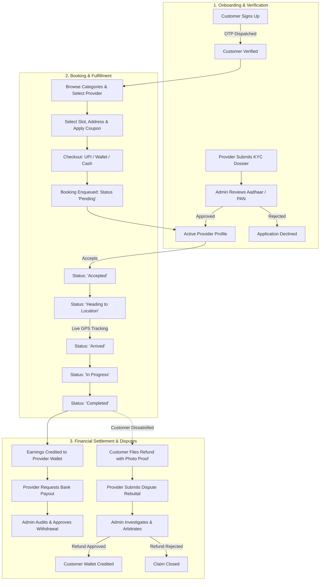

# ⚡ ServiceHub — On-Demand Home Services Booking & Field Operations Platform

[](https://www.python.org/)
[](https://www.djangoproject.com/)
[](https://www.sqlite.org/)
[](https://leafletjs.com/)
[](https://www.reportlab.com/)
[](LICENSE)

> **ServiceHub** is a production-grade, multi-role web platform and marketplace that bridges homeowners with verified independent service professionals (electricians, plumbers, carpenters, cleaners, painters, appliance technicians, and more). It delivers end-to-end service management featuring **6-stage booking lifecycles**, **simulated real-time GPS dispatch tracking**, **OTP verification via Gmail SMTP**, an **integrated wallet & dispute arbitration ledger**, and a **central administration control center**.

---

## 📑 Table of Contents

- [⚡ ServiceHub — On-Demand Home Services Booking \& Field Operations Platform](#-servicehub--on-demand-home-services-booking--field-operations-platform)
  - [📑 Table of Contents](#-table-of-contents)
  - [🌟 Key Architectural Highlights](#-key-architectural-highlights)
  - [👥 Core Portals \& Feature Breakdown](#-core-portals--feature-breakdown)
    - [1. 👤 Customer Experience Portal](#1--customer-experience-portal)
    - [2. 🛠️ Service Provider (Technician) Portal](#2-️-service-provider-technician-portal)
    - [3. 🛡️ Super Admin Control Center](#3-️-super-admin-control-center)
  - [🔄 System Workflow \& Lifecycle](#-system-workflow--lifecycle)
  - [📍 Real-Time Live Dispatch Tracking Simulation](#-real-time-live-dispatch-tracking-simulation)
  - [🔐 Security, Data Privacy \& Notification Architecture](#-security-data-privacy--notification-architecture)
  - [💻 Tech Stack Breakdown](#-tech-stack-breakdown)
  - [📁 Directory Structure](#-directory-structure)
  - [🚀 Getting Started \& Installation Guide](#-getting-started--installation-guide)
    - [Prerequisites](#prerequisites)
    - [Step-by-Step Installation](#step-by-step-installation)
  - [⚙️ Environment Configuration](#️-environment-configuration)
  - [📄 Automated User Manual PDF Compilation](#-automated-user-manual-pdf-compilation)
  - [🛣️ Endpoint \& Route Reference](#️-endpoint--route-reference)
  - [🗄️ Database Schema \& Models Overview](#️-database-schema--models-overview)
  - [🎨 Design System \& Theming](#-design-system--theming)
  - [🗺️ Roadmap \& Future Enhancements](#️-roadmap--future-enhancements)
  - [🤝 Contributing](#-contributing)
  - [📜 License \& Acknowledgments](#-license--acknowledgments)

---

## 🌟 Key Architectural Highlights

- **3-in-1 Unified Platform**: Seamlessly encapsulates Customer, Service Provider, and Super Admin workflows within an integrated Django architecture.
- **Interactive Live GPS Tracking**: Simulated step-by-step dispatch tracking on **Leaflet.js** maps with waypoint interpolation, route progress bars, and ETA indicators.
- **KYC & Document Verification Pipeline**: Digital uploads of **Aadhaar**, **PAN**, and **Business Certifications** with administrative review and approval gates.
- **Enterprise Ledger & Dispute Resolution**: Transparent wallet payouts, technician collection tracking, dispute filing with image proof, and administrative refund arbitration.
- **Granular Communication Engine**: Secure **Gmail SMTP** token integration sending beautifully styled HTML email receipts, with global and role-specific email kill-switches.
- **Modern Glassmorphic UI**: Powered by the custom **ServiceHub Design System** featuring dynamic Dark/Light theme toggling, fluid animations, and mobile-responsive layouts.

---

## 👥 Core Portals & Feature Breakdown

### 1. 👤 Customer Experience Portal
- **Smart Category Browsing**: Instant filtering across service niches:
  - ⚡ **Electrician** | 🔧 **Plumber** | 🪚 **Carpenter** | 🖌️ **Painter**
  - 🧹 **Cleaning** | ❄️ **AC Repair** | 🔌 **Appliance Repair** | 🛠️ **Custom Tasks**
- **Verified Provider Profiles**: Inspect technician experience, hourly/starting rates, completed job metrics, customer star ratings, and geographical operating radii.
- **Flexible Scheduling**: Select service date, time slot, and delivery address.
- **Multi-Address Book**: Store multiple household addresses (Home, Office, Parents) with custom labels and GPS coordinates.
- **Tri-Option Checkout**:
  - **Pay After Service / Cash**: Settle directly with the professional upon completion.
  - **In-App Digital Wallet**: Seamless 1-click debits from customer wallet balance.
  - **Simulated UPI Gateway**: Auto-generates unique transaction reference hashes (e.g., `TXN_SH_XXXXXXXX`).
- **Promotional Coupon Processing**: Apply discount promo codes with instant price deduction and validity checks.
- **Live Dispatch Radar**: Interactive map tracking technician journey in real-time once the booking status transitions to *Heading to Location*.
- **Favorites & Saved Technicians**: Star preferred technicians for quick re-booking.
- **Dispute & Refund Desk**: Submit refund claims for cancellations or unsatisfactory service with photographic evidence uploads.
- **Customer Support Tickets**: Raise inquiries with attachments and track administrative responses.

---

### 2. 🛠️ Service Provider (Technician) Portal
- **Onboarding & KYC Dossier**: Submit registration details, profile photo, service categories, Aadhaar card, PAN card, and business licenses for verification.
- **6-Stage Dispatch Workflow**:
  $$\text{Pending} \longrightarrow \text{Accepted} \longrightarrow \text{Heading to Location} \longrightarrow \text{Arrived} \longrightarrow \text{In Progress} \longrightarrow \text{Completed}$$
- **Earnings Wallet**: Automatically accrues collections from completed bookings; displays net wallet balance and financial transaction history.
- **Bank Coordinate Auditing**: Submit bank account credentials (Account Name, Account Number, IFSC, Branch) and proof photos (Passbook / Cancelled Cheque) subject to admin verification.
- **Payout Withdrawals**: Request cashouts to verified bank accounts once service collections reach the payout threshold.
- **Dispute Defense**: Review customer-raised refund claims and submit official provider counter-explanations before admin adjudication.
- **Custom Promotional Offers**: Create provider-specific discount coupons to drive local customer engagement.

---

### 3. 🛡️ Super Admin Control Center
- **KYC Verification Queue**: Inspect submitted Aadhaar/PAN documents; approve, decline, or request additional information from onboarding providers.
- **Bank Account Approvals**: Audit technician bank passbooks and account coordinates prior to authorizing cashouts.
- **Financial Ledger & Payout Desk**: Approve or reject technician withdrawal requests with automated ledger debiting.
- **Dispute & Refund Arbitration**: Review customer dispute tickets, examine uploaded screenshots, review provider counter-statements, and issue direct wallet refunds.
- **Monetization & Marketing Management**:
  - **Promotional Coupons**: Configure promo codes, percentage discounts, and expiration dates.
  - **Banner Advertisements**: Manage homepage marketing banners, image assets, and click-through URLs.
- **Global Communication Switches**:
  - Master Email Kill-Switch (toggles all outgoing mail platform-wide).
  - Role-specific email toggles (Customer notifications, Provider dispatches, Admin alerts).
- **Security & Moderation**: Suspend malicious customer accounts, deactivate providers, and manually schedule emergency administrative bookings.

---

## 🔄 System Workflow & Lifecycle



---

## 📍 Real-Time Live Dispatch Tracking Simulation

ServiceHub features an interactive live tracking interface powered by **Leaflet.js** and **OpenStreetMap**:

```
[Provider Base Coordinates]  ──►  ● ──► ● ──► ● ──► [Customer Delivery Address]
       (Live Route)                    (Step Interpolation)
```

- **Dynamic Coordinate Interpolation**: Computes intermediate waypoints between the technician's base coordinates and the customer's residence.
- **Developer & Demo Simulator Bar**: Includes built-in developer controls to step through dispatch stages (`Start Journey`, `Step Forward`, `Arrive`, `Reset`) to test tracking without requiring a live field driver.
- **RESTful Geolocation API**:
  - `GET /api/track/<booking_id>/`: Retrieves current provider coordinates, status, and ETA.
  - `POST /api/track/<booking_id>/control/`: Controls simulation steps (Forward, Reverse, Speed).
  - `POST /api/track/<booking_id>/update_location/`: Allows provider mobile client or browser to broadcast real-time GPS coordinates.

---

## 🔐 Security, Data Privacy & Notification Architecture

| Security Layer | Implementation Details |
| :--- | :--- |
| **Email Verification** | 6-digit cryptographic OTP tokens logged with expiration timestamps and single-use flags. |
| **Password Hashing** | Secure PBKDF2 with SHA-256 fallback compatibility. |
| **Financial Data Masking** | Bank account numbers masked to `XXXX XXXX XXXX 1234`; UPI IDs masked to `use****@bank`. |
| **Role-Based Access (RBAC)**| Session-isolated decorators ensuring customers cannot enter provider or admin consoles. |
| **Document Isolation** | Identity and verification documents stored under secure media paths (`media/documents/`, `media/passbooks/`). |
| **Resilient Email Delivery**| Gmail SMTP integration with formatted HTML templates, automated fallback logging on connection error. |

---

## 💻 Tech Stack Breakdown

- **Backend Framework**: [Python 3.10+](https://www.python.org/) & [Django 5.x](https://www.djangoproject.com/)
- **Database**: SQLite 3 (Production-ready configuration, seamlessly swappable to PostgreSQL or MySQL)
- **Frontend Engine**: Semantic HTML5, Modern CSS3 with CSS Custom Properties, ES6+ JavaScript
- **Design System**: ServiceHub Custom Design System (*Plus Jakarta Sans* typography, Glassmorphism, Dark/Light mode theme engine)
- **Mapping & Geolocation**: [Leaflet.js](https://leafletjs.com/) & [OpenStreetMap](https://www.openstreetmap.org/)
- **Document & PDF Generator**: [ReportLab 4.x](https://www.reportlab.com/)
- **Icons & Visuals**: [FontAwesome 6](https://fontawesome.com/)
- **Mailing Protocol**: Gmail SMTP with TLS over Port 587

---

## 📁 Directory Structure

```text
CustomerService/
├── csdata/                           # Core Django application module
│   ├── migrations/                   # Database migration history
│   ├── admin.py                      # Django admin site model bindings
│   ├── apps.py                       # Application configuration
│   ├── models.py                     # Schema: Cdetail, Employee, Bookings, Tickets, etc.
│   └── tests.py                      # Unit test suites
│
├── CustomerService/                  # Root project orchestrator
│   ├── context_processors.py         # Global context (Email settings, refund badges)
│   ├── settings.py                   # Django settings, security & SMTP setup
│   ├── urls.py                       # Master URL routing table (80+ routes)
│   ├── views.py                      # Multi-portal controllers & business logic
│   ├── wsgi.py                       # WSGI entry point for web servers
│   └── asgi.py                       # ASGI entry point for async servers
│
├── static/                           # Static assets
│   ├── css/
│   │   └── theme.css                 # ServiceHub Global Design System & Variables
│   ├── js/
│   │   └── theme.js                  # Dark/Light mode toggle & UI interactions
│   └── images/                       # Brand icons, banners, and placeholders
│
├── templates/                        # Responsive HTML templates
│   ├── home/                         # Public guest views (Index, About, Contact, Auth)
│   ├── user/                         # Customer views (Booking, History, Wallet, Live Track)
│   ├── employee/                     # Provider views (Service queue, Earnings, Disputes)
│   └── admin/                        # Admin views (KYC Review, Ad Banners, Ledger Desk)
│
├── media/                            # User and provider uploaded media
│   ├── documents/                    # Identity proofs (Aadhaar & PAN)
│   ├── passbooks/                    # Bank verification passbooks & cheques
│   ├── refund_proofs/                # Customer dispute screenshot evidence
│   └── provider_profiles/            # Technician avatar portraits
│
├── CustomerService_User_Manual.pdf   # Compiled executive and technical handbook
├── generate_manual_pdf.py            # Automated ReportLab PDF generator script
├── manage.py                         # Django administrative utility
├── requirements.txt                  # Python dependencies
├── .gitignore                        # Git ignore specifications
└── README.md                         # Project documentation
```

---

## 🚀 Getting Started & Installation Guide

### Prerequisites
Make sure you have the following installed on your machine:
- **Python 3.10** or higher ([Download Python](https://www.python.org/downloads/))
- **pip** (Python package manager)
- **Git** ([Download Git](https://git-scm.com/))

---

### Step-by-Step Installation

#### 1. Clone the Repository
```bash
git clone https://github.com/your-username/CustomerService.git
cd CustomerService
```

#### 2. Create and Activate a Virtual Environment
- **On Windows (PowerShell):**
  ```powershell
  python -m venv venv
  .\venv\Scripts\Activate.ps1
  ```
- **On Linux / macOS:**
  ```bash
  python3 -m venv venv
  source venv/bin/activate
  ```

#### 3. Install Required Dependencies
```bash
pip install -r requirements.txt
```

#### 4. Apply Database Migrations
Initialize the database tables and schema:
```bash
python manage.py makemigrations
python manage.py migrate
```

#### 5. Create a Superuser Account
To access both the custom Admin Console (`/aadmin/`) and standard Django Admin (`/django-admin/`):
```bash
python manage.py createsuperuser
```
Follow the interactive prompts to set your administrative username, email, and password.

#### 6. Launch the Development Server
```bash
python manage.py runserver
```
The platform will now be running at: **`http://127.0.0.1:8000/`**

---

## ⚙️ Environment Configuration

In `CustomerService/settings.py`, configure your email backend parameters to send real-time OTPs and booking alerts:

```python
# Email Configuration - Gmail SMTP
EMAIL_BACKEND = 'django.core.mail.backends.smtp.EmailBackend'
EMAIL_HOST = 'smtp.gmail.com'
EMAIL_PORT = 587
EMAIL_USE_TLS = True
EMAIL_HOST_USER = 'your-email@gmail.com'
EMAIL_HOST_PASSWORD = 'your-16-digit-google-app-password'
DEFAULT_FROM_EMAIL = 'ServiceHub <your-email@gmail.com>'
```

> [!TIP]
> **Generating a Google App Password**:
> 1. Go to your **Google Account** > **Security**.
> 2. Enable **2-Step Verification**.
> 3. Search for **App Passwords**, generate a token named `ServiceHub`, and paste the 16-character string into `EMAIL_HOST_PASSWORD`.

---

## 🛣️ Endpoint & Route Reference

### Public & Authentication
| Method | Endpoint | Description |
| :--- | :--- | :--- |
| `GET` | `/` | Homepage with hero search, categories, and verified pros |
| `GET` | `/about/` | Company background and trust guarantees |
| `GET` | `/contact/` | Contact details and support desk inquiries |
| `GET` | `/provider/<id>/` | Public showcase of technician profile and reviews |
| `GET, POST` | `/signup/` | Customer registration with automated OTP dispatch |
| `GET, POST` | `/verify-otp/` | OTP verification step to activate customer accounts |
| `GET, POST` | `/register-provider/`| Technician KYC onboarding dossier submission |
| `GET, POST` | `/signin/` | Multi-role authentication (Customer / Provider / Admin) |
| `GET` | `/logout/` | Secure session termination |

### Customer Portal
| Method | Endpoint | Description |
| :--- | :--- | :--- |
| `GET` | `/bookservice/` | Customer dashboard: active bookings & recommendations |
| `GET, POST` | `/profile/` | Edit personal details, multi-address book, and UPI info |
| `GET` | `/favorites/` | Saved/bookmarked service professionals |
| `POST` | `/toggle_favorite/<id>/` | Add or remove a technician from favorites |
| `GET` | `/servicehistory/` | Completed, cancelled, and disputed booking log |
| `GET, POST` | `/payment/<id>/` | Checkout: select date, slot, address, and payment method |
| `POST` | `/validate_coupon/` | Asynchronous AJAX coupon code validation |
| `GET, POST` | `/request_refund/<id>/`| Initiate dispute/refund request with image upload |
| `GET, POST` | `/raiseticket/` | Submit a customer support ticket |

### Live Dispatch & Geolocation Tracking
| Method | Endpoint | Description |
| :--- | :--- | :--- |
| `GET` | `/track/<id>/` | Interactive Leaflet.js live tracking interface |
| `GET` | `/api/track/<id>/` | JSON coordinates, ETA, and status telemetry |
| `POST` | `/api/track/<id>/control/` | Dispatch simulator control step (Dev/Demo) |
| `POST` | `/api/track/<id>/update_location/` | Provider mobile client coordinate broadcasting |

### Service Provider Portal
| Method | Endpoint | Description |
| :--- | :--- | :--- |
| `GET` | `/employeeservicebooked/` | Provider workbench: incoming & active orders |
| `POST` | `/agent/toggle_booking/<id>/<act>/` | Transition order status (*Accept, Heading, Arrived, Complete*) |
| `POST` | `/agent/update_bank/` | Submit/update bank account details & passbook photo |
| `POST` | `/agent/request_withdrawal/` | Request payout from wallet to verified bank account |
| `GET, POST` | `/agent/refund_complaints/` | Review and contest customer refund claims |
| `POST` | `/agent/add_offer/` | Publish provider-specific discount promo codes |

### Administration Control Center
| Method | Endpoint | Description |
| :--- | :--- | :--- |
| `GET` | `/aadmin/` | Executive administration overview & metrics |
| `GET` | `/admin/pending-providers/` | KYC application queue |
| `GET, POST` | `/admin/review-provider/<id>/`| Inspect Aadhaar/PAN and approve/reject provider |
| `GET` | `/admin/wallet/` | Financial ledger: withdrawal payout approvals |
| `POST` | `/admin/approve_withdrawal/<id>/` | Confirm bank transfer & debit provider wallet |
| `GET` | `/admin/refunds/` | Dispute arbitration desk (Photo proof vs rebuttal) |
| `POST` | `/admin/confirm_refund/<id>/` | Adjudicate dispute and issue customer wallet credit |
| `GET, POST` | `/admin/manage_offer/` | Create and manage discount coupons |
| `GET, POST` | `/admin/manage_ad/` | Upload and schedule homepage promotional banners |
| `POST` | `/admin/toggle_global_email/`| Master notification kill-switch |

---

## 🗄️ Database Schema & Models Overview

```
 ┌──────────────────────┐         ┌──────────────────────┐
 │       Cdetail        │         │       Employee       │
 │  (Customer Profile)  │         │ (Service Technician) │
 ├──────────────────────┤         ├──────────────────────┤
 │ unique (PK)          │         │ unique (PK)          │
 │ name, mail, phone    │         │ name, email, phone   │
 │ addresses (JSONField)│         │ service_provided     │
 │ wallet_balance       │         │ rating, experience   │
 │ bank_account_num     │         │ starting_price       │
 │ live_lat, live_lng   │         │ bank coordinates     │
 └──────────┬───────────┘         └──────────┬───────────┘
            │                                │
            │      ┌──────────────────┐      │
            └─────►│     Bookings     │◄─────┘
                   ├──────────────────┤
                   │ unique (PK)      │
                   │ email, status    │
                   │ service_date     │
                   │ user_lat/lng     │
                   │ emp_lat/lng      │
                   │ price, discount  │
                   │ refund_status    │
                   │ refund_proof_pic │
                   └──────────────────┘
```

1. **`Cdetail`**: Customer records, hashed credentials, multi-address JSON structures, wallet balance, and notification flags.
2. **`Employee`**: Verified technicians, service categories, pricing, ratings, live latitude/longitude, and audited bank credentials.
3. **`Bookings`**: Core transaction model linking customer and provider with scheduled timeslots, 6 status stages, payment modes, and refund metadata.
4. **`ProviderRegistration`**: Unapproved technician dossiers containing Aadhaar and PAN file uploads awaiting administrative review.
5. **`OTPVerification`**: Ephemeral 6-digit one-time password security tokens with timestamp expiration.
6. **`WalletTransaction`**: Financial audit ledger tracking service earning collections and bank withdrawal disbursements.
7. **`Offer`**: Promotional coupons with percentage discounts, custom codes, and expiry dates.
8. **`Advertisement`**: Platform banners with scheduling dates, image assets, and direct hyperlinks.
9. **`Ticket`**: Customer service tickets with complaint descriptions and file attachments.
10. **`AdminSetting`**: Key-value toggle switches controlling global and category-specific email dispatches.

---

## 🎨 Design System & Theming

ServiceHub incorporates a custom-built design system defined in `static/css/theme.css`:
- **Color Palette**: Modern Indigo (`#4F46E5`), Sky Blue (`#0EA5E9`), Emerald Green (`#10B981`), and Slate neutrals.
- **Glassmorphism**: Backdrop blur elements with subtle borders (`backdrop-filter: blur(20px)`).
- **Dark/Light Mode**: Dynamic theme switcher powered by `theme.js` which automatically remembers user preference across browser sessions via `localStorage`.

---

## 🗺️ Roadmap & Future Enhancements

- [ ] **Real-time WebSockets**: Upgrade live tracking from HTTP polling to **Django Channels** and WebSockets for sub-second telemetry updates.
- [ ] **Live Payment Gateways**: Integrate production payment webhooks for **Razorpay** and **Stripe**.
- [ ] **Native Mobile Application**: Build companion mobile apps using **React Native** or **Flutter** for on-the-go provider dispatch.
- [ ] **SMS Integration**: Complement Gmail notifications with **Twilio** or **Fast2SMS** fallback for instant field alerts.
- [ ] **Customer Reviews & Photos**: Allow customers to upload post-service work photos alongside star ratings.

---

## 🤝 Contributing

Contributions are welcome and appreciated! To contribute:

1. **Fork** the Project.
2. Create your Feature Branch:
   ```bash
   git checkout -b feature/AmazingFeature
   ```
3. Commit your Changes:
   ```bash
   git commit -m 'Add some AmazingFeature'
   ```
4. Push to the Branch:
   ```bash
   git push origin feature/AmazingFeature
   ```
5. Open a **Pull Request**.

---

## 📜 License & Acknowledgments

Distributed under the **MIT License**. See `LICENSE` for more information.

- **Author & Creator**: **Bhushan Ingale**
- **Special Thanks**: Built with Django, Leaflet.js, and ReportLab.
